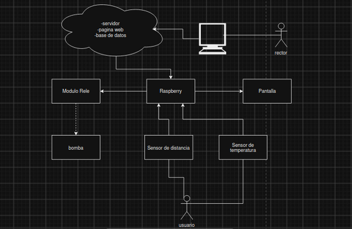

# SafeKitchen
SafeKitchen es un sistema automatizado de control de acceso e higiene diseñado para cuidar a todo el equipo al ingresar a la zona de trabajo o cocina. Su objetivo es hacer que el acceso sea rápido, seguro y totalmente autónomo.El tótem se encarga de verificar que entres bajo las mejores condiciones de salud: mide temperatura corporal sin contacto y activa de forma automática el dispensador de sanitizante para tus manos.

Guía de Uso Paso a Paso:

-Acércate al Tótem:
Paso 1.Colócate frente al dispositivo y ubícate a una distancia cómoda de unos 5 a 10 centímetros.
-Coloca la Muñeca en el Sensor:
Paso 2.Extiende tu brazo y coloca la muñeca frente al sensor de temperatura superior. Mantén la posición unos segundos hasta que el sistema capture la lectura de forma automática.
-Verifica tu Acceso:
Paso 3.Si estás bien (temperatura normal): La pantalla se pondrá de color verde, el dispensador liberará automáticamente el sanitizante para tus manos y podrás ingresar con total tranquilidad.
Si el sistema detecta fiebre o temperatura elevada: La pantalla se pondrá de color rojo y escucharás una señal sonora intermitente (buzzer). En este caso, el acceso quedará pausado por seguridad y deberás reportarte con el responsable de salud o un coordinador.

Link a repositorio de github: 
- "https://github.com/abrildlherbas/SafeKitchen.git" 